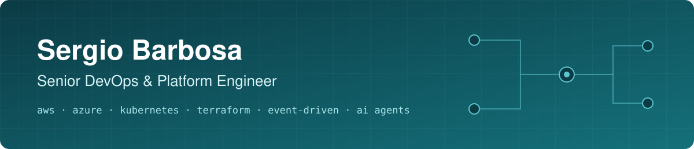
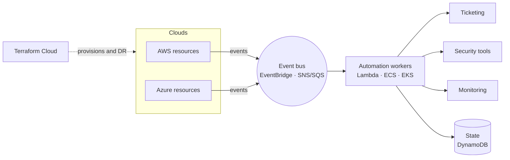
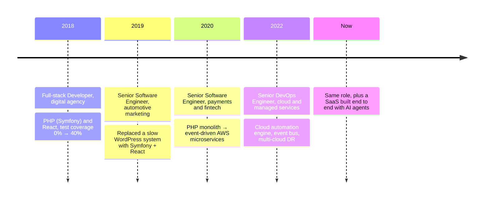

  

  
  
  

**I build the platform developers stop filing tickets about.** I started out writing the apps (PHP, Python, React) and now run the cloud they live on, so I design infrastructure from the developer's side of the ticket.

## 🛠️ What I do

| | |
|---|---|
| ☁️ **Cloud automation** | Engines that provision and wire up AWS and Azure, so nobody clicks through a console or waits on a ticket. |
| ⚡ **Event-driven platforms** | EventBridge, SNS/SQS and Lambda: infrastructure that reacts to what happens instead of running on cron. |
| 🔄 **Zero-downtime modernization** | Old production systems upgraded to current versions while they keep serving traffic. |
| 🛡️ **Resilience and visibility** | Multi-cloud disaster recovery, plus ELK and New Relic so problems show up before customers notice. |
| 🤖 **AI-assisted engineering** | AI coding agents in real delivery work, and software built for them (MCP servers, agent workflows). |

## 📈 Results

<table>
  <tr>
    <td align="center" width="25%"><h2>90%</h2>less manual AWS/Azure provisioning</td>
    <td align="center" width="25%"><h2>100%</h2>of event-emitting cloud resources on one event bus</td>
    <td align="center" width="25%"><h2>0</h2>minutes of downtime across major upgrades</td>
    <td align="center" width="25%"><h2>8+</h2>third-party tools onboarded automatically</td>
  </tr>
</table>

- Upgrades on live platforms: **PHP 7.4→8.5, Python 3.7→3.13, Symfony 3.4→8.1, Vue 2→3, React 16→19**, with their CVEs cleared and about 4 years more support life.
- Test coverage on a client codebase from **0% to 40%**, and 25% fewer production bugs.

## 🧭 How my cloud automation works

Every change in AWS or Azure becomes an event. Workers pick it up and set up the ticketing, security and monitoring tools around the resource, with no manual step.

## 🧰 Stack

**Cloud** 

**Infrastructure and operations** 

**Observability** 

**Languages and frameworks** 

**Architecture and AI** 

## 🗺️ Career

## 🚀 Right now

I'm designing, building and running a full SaaS product end to end with AI agents: Symfony + React, payments, background jobs on shared hosting, an MCP server for AI clients and a Telegram bot. That's most of my **5,000+ contributions** in the past year.

---

<b>Hiring for platform, DevOps or SRE?</b> The fastest way to reach me is <a href="https://www.linkedin.com/in/sbarbosa115">LinkedIn</a>.

